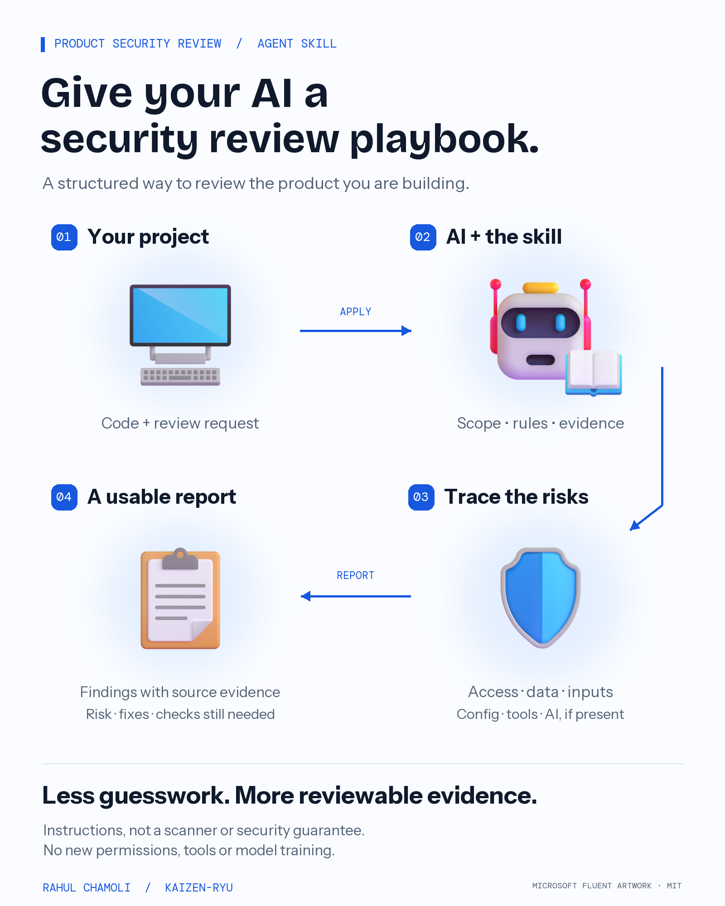

# Product Security Review

A security review playbook for coding agents, created by **Rahul Chamoli**.

Give your agent a repeatable way to inspect a web app, API or AI-enabled product: establish scope, trace trust boundaries, separate confirmed gaps from unknowns, and produce findings an engineer can verify.

[Download the skill](dist/product-security-review.skill) · [Read the instructions](skills/product-security-review/SKILL.md) · [Validation evidence](docs/validation.md)



## What it adds

- **A review method:** trace routes, middleware, services and data access before raising a finding.
- **Context-sensitive controls:** authentication, object/tenant authorization, inputs, configuration and integrations. Add the AI profile for RAG, memory, agents and MCP tools.
- **Evidence discipline:** relative file paths, line numbers, short source excerpts, confidence and impact assumptions.
- **A useful handoff:** PASS / GAP / UNKNOWN / N/A, prioritized fixes, proposed regression checks and explicit work not run.

It does not add a scanner, tools, permissions, network access or model training. It cannot certify security, prove compliance or replace a specialist review.

## Use it

Example request:

> Use product-security-review to review this repository's invoice and assistant APIs. Inspect source only. Trace shared middleware and tenant boundaries. Report findings with evidence, prioritized fixes, unknowns and regression tests to run. Do not change files or contact external systems.

Use the skill on repositories and environments you are authorized to review. Fixes and executable checks require their own authorized scope.

### Claude Code

Copy `skills/product-security-review/` into your target repository at:

```text
.claude/skills/product-security-review/
  SKILL.md
  references/
```

Then ask Claude Code to use it, or invoke `/product-security-review` with the review scope. Follow the current [Claude Code skills documentation](https://code.claude.com/docs/en/skills) for discovery and invocation details.

### Codex

Copy the same canonical folder into your target repository at:

```text
.agents/skills/product-security-review/
  SKILL.md
  references/
```

Then ask Codex to use `$product-security-review`. See the official [Codex skills documentation](https://learn.chatgpt.com/docs/build-skills).

### Other agents and the `.skill` archive

The package is a ZIP-compatible archive containing `product-security-review/SKILL.md`, its references and the license. Use an import facility only if your host supports that format; otherwise extract and copy the folder to the host's documented skill location. Do not rename the folder or flatten its references.

The canonical structure follows the [Agent Skills specification](https://agentskills.io/specification). Hosts differ in discovery, tools and permissions. Manual-context behavior was checked with native Claude Code and Codex CLIs; automatic discovery, chat-app imports and other hosts are **not tested**. No global provider configuration is changed by this repository.

## Try the review fixture

Ask your agent to review [the synthetic source](examples/synthetic-app/routes.ts) using [its explicit context](examples/synthetic-app/context.md). It is an inert, deliberately flawed excerpt, not an app to deploy. The fixture includes authorization gaps, valid controls and hostile retrieved text to test evidence handling. It is not a security benchmark.

## Maintain and package

Python 3.11+; packaging and its tests use only the standard library:

```sh
python -m unittest discover -s tests -v
python tools/package_skill.py
```

The archive is deterministic and includes only the skill resources and MIT license. The poster is separate from the skill's model context. To rebuild it, install the optional pinned visual dependency in an isolated environment, then run:

```sh
python -m pip install -r tools/requirements-visual.txt
python tools/render_visual.py
```

Read [the runbook](docs/runbook.md), [changelog](CHANGELOG.md) and [design decision](decisions/0001-portable-evidence-led-skill.md) before contributing. Keep changes small and preserve truthful limits and evidence.

## License and credits

Original instructions and code: [MIT](LICENSE). Microsoft Fluent Emoji illustrations and bundled fonts keep their own [license notices](assets/THIRD_PARTY_NOTICES.md). Independent community work; no vendor endorsement is implied.
