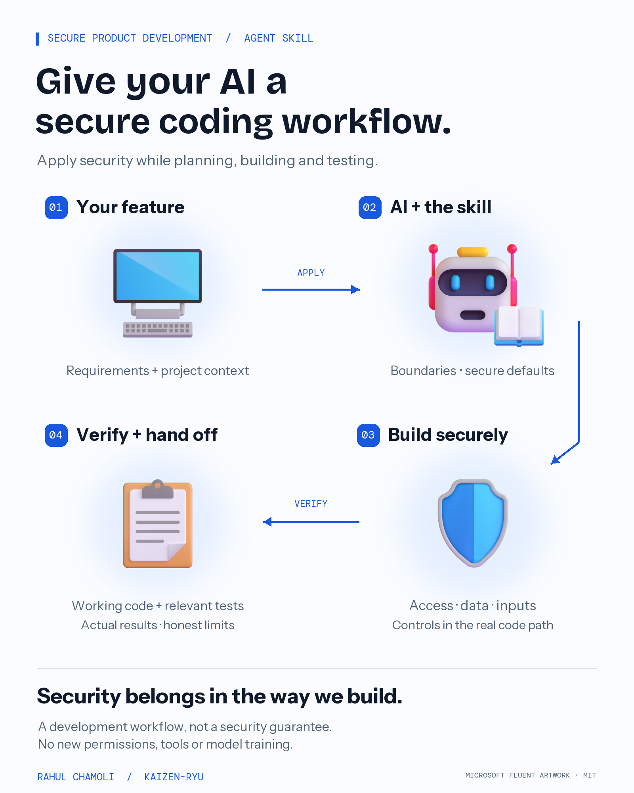

# Secure Product Development

**A secure coding workflow for AI agents, created by Rahul Chamoli.**

Use security as part of how an agent plans, writes and verifies product code. The deliverable is an implemented feature with relevant checks and honest limits. The skill guides the work throughout development; it does not require a separate audit report for every task.

[Download the skill](dist/secure-product-development.skill) · [Read the workflow](skills/secure-product-development/SKILL.md) · [Validation evidence](docs/validation.md)



## The working method

1. **Understand:** feature contract, existing architecture, identity, data and action boundaries.
2. **Implement:** trusted server identity, scoped data access, validated inputs and business actions, safe secret handling and appropriate framework controls.
3. **Verify:** the allowed path and relevant unauthorized, cross-tenant, tampered-input and retry paths.
4. **Hand off:** working code, actual checks and results, unknowns and the next action.

For AI-enabled features, the host enforces tool permissions and approvals; retrieval/memory stays inside the permitted project or tenant. A model's decision or a request-body `approved` flag cannot grant authority.

The work scales to the change. A copy or styling edit does not trigger an unrelated security redesign. RLS, CAPTCHA, specific headers and named scanners are not universal requirements.

## Example: while building an invoice feature

An agent should put the trusted tenant check in the data-access path as it implements the feature, then test that another tenant's invoice is inaccessible. A note saying “add authorization later” is not the implementation.

Try the complete [synthetic assignment](examples/secure-coding-task/assignment.md), [implementation](examples/secure-coding-task/implementation.mjs) and [24 executable checks](examples/secure-coding-task/verify.mjs):

```sh
node --test examples/secure-coding-task/verify.mjs
```

The example prepares a refund intent only. It never transfers money. A real executor would need its own atomic validation, approval consumption and idempotency. It is a framework-neutral learning example, not an application to deploy.

## Install and use

### Claude Code

Copy `skills/secure-product-development/` into your project's `.claude/skills/secure-product-development/`. Ask Claude Code to use it or invoke `/secure-product-development`. See the [official skill documentation](https://code.claude.com/docs/en/skills).

### Codex

Copy the same folder into `.agents/skills/secure-product-development/` in your project. Ask Codex to use `$secure-product-development`. See the [official skills documentation](https://learn.chatgpt.com/docs/build-skills).

### Make it part of normal project work

Add [this short instruction](integrations/project-instruction.md) to the project's AGENTS.md, CLAUDE.md or host equivalent after installation. Merge with existing guidance; do not replace the file. Example request:

> Use secure-product-development while implementing this feature. Follow our existing framework and architecture, put authorization and validation on the actual execution path, and verify the relevant allowed and rejection paths. Explain the checks that really ran and what remains unknown.

Hosts differ in automatic selection and permissions. **Skills are guidance, not enforcement.** Verify that the agent loads the skill, and keep real enforcement in tests, CI, permissions and runtime controls. This repository does not edit global AI configuration or grant new tools, access or spending authority.

### Other agents

The canonical folder follows the [Agent Skills specification](https://agentskills.io/specification). The `.skill` download is ZIP-compatible and contains the workflow, four references and MIT license. Import it only in a host supporting that format; otherwise extract and use its documented skill location. Preserve references and license when redistributing. Do not assume universal host support.

## What was tested

The same workflow context was supplied to native Claude Code and Codex CLIs for a synthetic implementation task. Both produced code, then each implementation passed **24 held-out checks** after source inspection. Five package tests also passed locally. The skill instructions received an independent Claude review. See [the detailed record and limitations](docs/validation.md).

This is a small behavior check, not proof of a security benefit, universal compatibility or production readiness. No baseline comparison, automatic discovery test, live payment/auth deployment or penetration test was performed.

## Build and maintain

Python 3.11+ for the package, Node.js 20+ for the synthetic example. Neither needs third-party packages:

```sh
python -m unittest discover -s tests -v
python tools/package_skill.py
node --test examples/secure-coding-task/verify.mjs
```

Optional poster rebuild:

```sh
python -m pip install -r tools/requirements-visual.txt
python tools/render_visual.py
```

The archive contains only instructions, references and license. The poster and its fonts are separate from model context. Read [the runbook](docs/runbook.md), [changelog](CHANGELOG.md) and [the implementation decision](decisions/0002-secure-implementation-workflow.md) before changing the skill.

## Version history and limits

Version 2 changes the original Product Security Review skill into an implementation workflow. Original evaluations remain historical; they do not validate this new behavior. The current record includes real code generation and executable checks. Prior distribution and review material are deprecated; use the `secure-product-development` package and folder.

The skill does not certify security, compliance or deployment readiness. It adds no scanner, permissions, tools, network access or model-weight changes.

Original instructions and code: [MIT](LICENSE). Microsoft Fluent Emoji artwork and bundled fonts retain their [license notices](assets/THIRD_PARTY_NOTICES.md). No vendor endorsement is implied.
